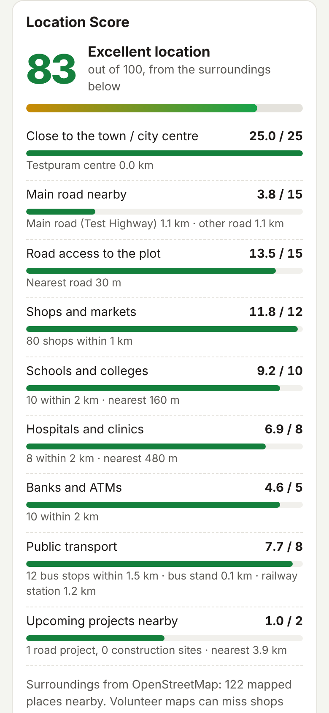
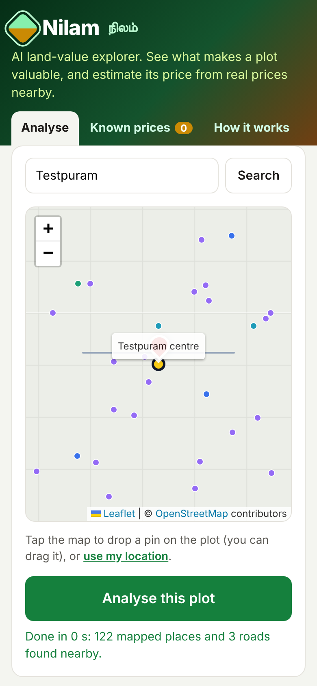
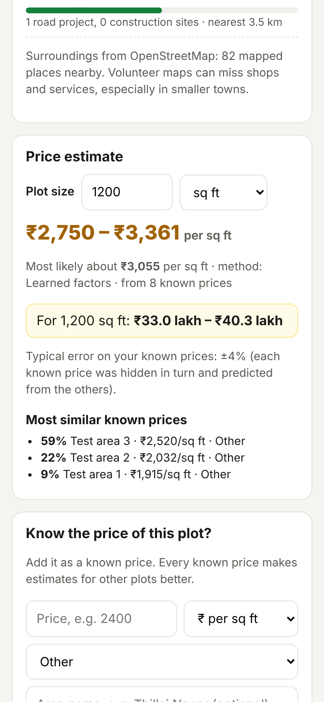
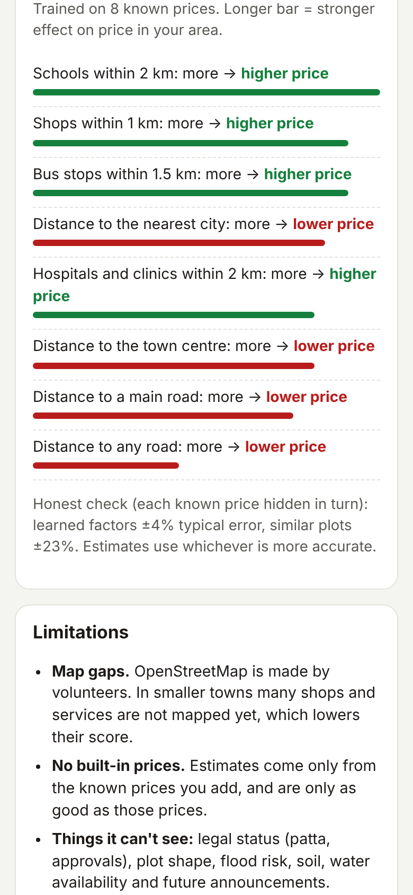
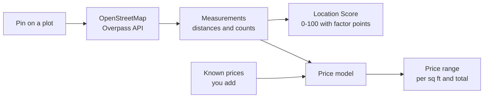

# Nilam (நிலம்): AI land-value explorer
**Live demo:** https://YOUR-USERNAME.github.io/nilam/. It works on a phone or a laptop.
**Status:** working prototype. Checked with automated tests and a made-up test town. **Not yet tested with real
prices** (results will be added here).
Nilam helps answer a question every land buyer in India asks: *is this plot well located, and what is it really
worth?* Drop a pin on a plot (or paste its coordinates or a Google Maps link) and Nilam:

1. reads the plot's surroundings **live from OpenStreetMap**: town centre, main roads, road access, shops,
   schools, hospitals, banks, bus stops, railway station, and roads under construction;
2. gives an explainable **Location Score (0–100)** that shows the points for each factor and the facts behind them;
3. **estimates the price** from known prices nearby, such as government guideline values or real sales. It
   compares similar plots like a valuer does, and with 6 or more known prices it learns which factors move
   prices in that area. It reports its own error honestly.

| Location Score | Surroundings on the map | Price estimate | What the AI learned |
|---|---|---|---|
|  |  |  |  |

Screenshots are from the automated browser test, which uses a <b>made-up test town with made-up prices</b>
because the test machine had no internet. On a phone, the real OpenStreetMap data and streets appear.

## Why

Land prices depend mostly on location: how close a plot is to the town centre, whether it is on or near a main
road, and what shops, schools, hospitals and transport are nearby. Buyers usually rely on brokers and word of mouth.
Nilam makes those location factors visible and measurable for any plot, and turns a handful of known prices into an
estimate with an honest error range.

## How it works

1. **Read** (`osm.js`). A single Overpass API request fetches roads within 3 km, streets within 300 m, shops
   within 1 km, schools, hospitals and banks within 2 km, bus stops, bus stands, railway stations, construction
   sites, roads under construction, and the nearest towns and cities.
2. **Measure** (`features.js`). Coordinates are converted to metres around the plot, and the app measures the
   distance to the nearest point of each road and counts the places within each radius.
3. **Score** (`score.js`). Nine factors, each worth up to a set number of points: centre 25, main road 15, road
   access 15, shops 12, schools 10, hospitals 8, banks 5, transport 8, upcoming projects 2. **These weights are my
   starting assumptions**, based on common real-estate practice. They are not learned from prices.
4. **Compare** (`valuation.js`). The *similar plots* method (k-nearest neighbours) gives the most say to known
   prices whose surroundings look most like the plot's and which are nearby.
5. **Learn.** With 6 or more known prices, a *learned factors* model (ridge regression on log price) learns how
   much each factor moves prices locally. Both methods are checked by **leave-one-out**: each known price is
   hidden in turn and predicted from the others. The estimate uses the method with the smaller typical error, and
   that error sets the width of the price range.

The app supports Indian units (sq ft, cents, grounds, acres, sq m) and shows ₹ amounts in lakh and crore.

## Results so far

- **Automated tests:** 11 pass (`node --test unit.test.js`). They cover distance to roads, amenity counts,
  detection of upcoming projects, the score adding up, the estimate on unseen plots, the error check, units,
  ₹ formatting, and reading coordinates in decimal, degrees-minutes-seconds and Google Maps link formats.
- **Browser test:** a phone-sized headless Chrome walked through search, analysis, adding 8 known prices,
  estimating a new plot, and the learned factors. There were no errors. In the made-up test town, the estimated
  range for an unseen plot contained its made-up true price.
- **Real-world accuracy: not measured yet.** The test town's prices follow a clean formula, so they say nothing
  about real accuracy. The next step is to add 6–10 real guideline values or sale prices and report the
  leave-one-out error here.

## Use it

1. Search a place, tap the map, or paste the plot's **coordinates** (e.g. `10.8050, 78.6856`, `10°48'18"N 78°41'08"E`,
   or a Google Maps link). In Google Maps, press and hold a spot to see its coordinates.
2. Tap **Analyse this plot** and read the Location Score and its factors.
3. If you know the plot's price, add it under **Know the price of this plot?** Good sources are government
   guideline values (tnreginet.gov.in in Tamil Nadu), registered sale prices, or asking prices, which are less
   reliable.
4. Once several known prices are saved, every new plot gets a price range. **How it works** shows what the AI
   learned.

Known prices are stored only on your device, and you can download them as a file.

**Share a plot:** after an analysis the address bar holds a link such as `…/nilam/#10.805000,78.685600`. **Copy link to
this plot** copies it, and anyone who opens it sees the same plot analysed.

## Files

| File | What it does |
|---|---|
| `index.html`, `style.css` | Screens: Analyse · Known prices · How it works |
| `app.js` | Connects everything to the screen |
| `osm.js` | Overpass query (surroundings) and Nominatim place search |
| `coords.js` | Reads pasted coordinates and Google Maps links; shareable plot links |
| `features.js` | Turns map data into distances and counts |
| `score.js` | Location Score and its factors |
| `valuation.js` | Similar plots (k-NN), learned factors (ridge regression), leave-one-out error, units |
| `map.js` | Leaflet map: pin, roads, places, known prices |
| `store.js` | Saving known prices on the device |
| `unit.test.js` | Automated tests (`node --test unit.test.js`, Node.js 18+) |
| `synthetic-osm.js` | Made-up test town for tests only. **Not real data.** |

## Limitations

- **Map gaps.** OpenStreetMap is volunteer-made, and many shops and services in smaller towns are not mapped yet,
  which can lower a plot's score.
- **No built-in prices.** Estimates are only as good as the known prices entered, and a few prices give wide ranges.
- **Things it can't see:** legal status (patta, approvals), plot shape and size effects, flood risk, soil, water,
  and future government announcements.
- **Not a valuation report.** It's a learning prototype, not a certified valuation.

## Next steps (not built yet)

- **Look up a plot by its survey number.** Tamil Nadu's land records (TNGIS, e-Services, TNREGINET) are websites for
  people, with no open data service for apps. Until one exists, find the plot on the official TNGIS map or on Google
  Maps and paste its coordinates into Nilam.
- A Node.js + Express + MongoDB backend so many users can share known prices and build a price map of a town.
  A React dashboard on top would make it a full MERN app.
- Flood-risk and elevation layers, and night-time satellite lights as a development signal.
- Tracking price trends over time from repeated guideline-value revisions.

## How I built it

This is an independent project, not part of an internship or job. I built it with help from an AI coding assistant
(Claude). I am studying each part so that I can explain, defend and extend it myself.

## Credits and licence

- Map data © [OpenStreetMap](https://www.openstreetmap.org/copyright) contributors (ODbL), via the
  [Overpass API](https://overpass-api.de) and [Nominatim](https://nominatim.org). Map library:
  [Leaflet](https://leafletjs.com) (BSD-2-Clause).
- Code: MIT licence (see `LICENSE`).
